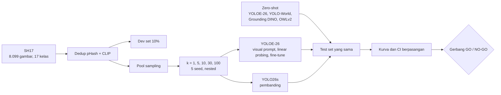

<div align="center">

# Open-Vocab PPE Label Efficiency

### Berapa label yang benar-benar dibutuhkan untuk mendeteksi Alat Pelindung Diri?

*How few labels does PPE detection really need? Mapping the zero-shot → few-shot → fully supervised curve with modern open-vocabulary detectors.*


</div>

Melabeli ribuan foto pekerja itu mahal. Detektor open-vocabulary menjanjikan jalan pintas: cukup tulis `"helmet"`, modelnya langsung mencari helm. Tapi seberapa jauh janji itu bertahan pada APD, terutama untuk kelas pelanggaran seperti tangan tanpa sarung tangan? Dan pada titik mana detektor biasa menyusul?

Repo ini menjawabnya dengan satu kurva utuh, dari **nol label** sampai **data penuh**, pada split dan test set yang sama untuk semua model.

> **Status jujur:** ini studi pendahuluan untuk calon skripsi S1 Informatika dan masih berjalan. Tahap 1 sudah jalan, Tahap 2 belum dimulai, **belum ada kesimpulan penelitian**, dan topiknya belum diajukan ke dosen pembimbing.

## Kenapa ini menarik

Penelitian sebelumnya berhenti di salah satu ujung kurva: zero-shot saja, atau supervised saja, atau APD dengan pipeline captioning tanpa bounding box. Sejauh pencarian kami, belum ditemukan studi yang memetakan **zero-shot → few-shot → data penuh** untuk APD dengan detektor open-vocabulary modern. Pencarian ini terbatas, jadi belum membuktikan studinya tidak ada.



## Yang bikin eksperimen ini bisa dipercaya

| Praktik | Kenapa penting |
|---|---|
| **Kriteria GO/NO-GO ditulis sebelum hasil keluar** | Keputusan tidak bisa diakali setelah melihat angka, termasuk kalau hasilnya negatif |
| **5 seed, 95% CI, selisih berpasangan** | Tiap metode dinilai pada sampel gambar yang sama, jadi selisihnya bukan keberuntungan sampling |
| **Sampel k-shot nested** | Sampel k = 5 selalu memuat k = 1, mengikuti protokol TFA |
| **Dedup embedding CLIP** | Foto satu sesi yang lolos pHash tidak bocor dari train ke test |
| **Test set tidak dipakai memilih apa pun** | Jadwal dipilih di dev set, baru dikunci |
| **Determinisme diuji** | Run ulang harus menghasilkan AP identik sampai 6 desimal; itu kriteria gerbang, bukan klaim |

## Temuan rekayasa yang sudah terukur

Ini hasil validasi pipeline, **bukan hasil penelitian**:

- **Dedup CLIP ambang 0,95 membuang 926 dari 6.466 gambar train (14,3%).** Cek visual menunjukkan banyak pasangan di sekitar ambang itu memang foto satu sesi.
- **Worker lebih banyak justru lebih lambat di laptop 6 GB ini:** satu epoch data penuh turun dari 3,05 menit (8 worker) ke 1,9 menit (1 worker), dan 12 worker gagal karena memori virtual Windows habis.
- **Kelas `face-guard` dan `medical-suit` tidak mencapai 100 objek di pool** (92 dan 81), jadi pada k = 100 keduanya memakai semua yang tersedia, dan itu dicatat.

## Dibangun untuk listrik yang suka mati

Seluruh eksperimen jalan di satu laptop RTX 4050 6 GB, di kota yang sering mati listrik. Antreannya dirancang supaya tahan banting:

- **Lanjut dari epoch terakhir** setelah dihentikan paksa, memakai cadangan kalau `last.pt` rusak (diuji dengan file yang sengaja dirusak)
- **Jeda rapi:** `--jeda` menghentikan antrean tanpa merusak hasil (diuji)
- **Pantau charger:** kalau listrik hilang, job dimatikan lalu diulang saat listrik kembali (baru diuji lewat simulasi)
- **Deteksi macet:** run yang menggantung diulang otomatis (terpasang, belum pernah terpicu dalam kondisi nyata)

## Protokol singkat

| Komponen | Isi |
|---|---|
| Dataset utama | SH17, val resmi jadi test set (1.620 gambar) |
| Uji lintas dataset | Construction-PPE, semua split, tidak ikut training |
| Open-vocabulary | YOLOE-26, YOLO-World-v2, Grounding DINO, OWLv2 |
| Pembanding | YOLO26s, dilatih pada data yang sama |
| Skenario | Zero-shot; k = 1, 5, 10, 30, 100; data penuh |
| Metrik | mAP50, mAP50-95, AP per kelas, recall kelas pelanggaran, FPS |

Rincian lengkap dan semua kriteria keputusan ada di [`rencana_eksperimen.md`](rencana_eksperimen.md).

## Hasil

Kurva dan tabel masuk ke sini setelah gerbang terkait selesai. Sengaja belum ada angka kinerja di README, karena angka sebelum protokol selesai bisa menyesatkan.

| Gerbang | Pertanyaan | Status |
|---|---|---|
| 0. Literatur | Apakah penelitian yang sama sudah ada? | Lolos |
| 1. Teknis | Apakah pipeline sah dan jadwal sudah benar? | Belum lolos: RAM bebas 2,91 GB, batas 3,0 GB; kriteria lain terpenuhi |
| 2. Sinyal | Apakah kurvanya informatif? | Menunggu |
| 3. Akhir | GO atau NO-GO? | Menunggu |

## Isi repo

```
scripts/             Pipeline: dedup, sampling, training, evaluasi, antrean, analisis, gerbang
data/splits/         Daftar gambar per split dan sampel k-shot
results/runs*/       Metrik per run dalam JSON
results/hasil/       Ringkasan dan status gerbang
rencana_eksperimen.md  Protokol terkunci dan kriteria GO/NO-GO
```

**Gambar dataset dan bobot model tidak disertakan.** Unduh dataset dari sumber resminya. Daftar split memakai path lokal, jadi perlu disesuaikan.

## Menjalankan

Pasang PyTorch dari index CUDA dulu, lalu `ultralytics` **tanpa `-U`**, karena `-U` bisa menimpa PyTorch dengan versi CPU. Versi lengkap ada di [`requirements-lock.txt`](requirements-lock.txt), dan urutan skrip di [`scripts/README.md`](scripts/README.md).

```bash
python scripts/09_queue.py tahap1          # jalankan; job selesai dilewati
python scripts/09_queue.py tahap1 --list   # lihat status
python scripts/09_queue.py --jeda          # berhenti dengan rapi
python scripts/14_estimasi.py              # perkiraan sisa waktu
```

## Rujukan utama

- Ahmad & Rahimi (2024). SH17. arXiv:2407.04590
- Gil & Lee (2024). *Automation in Construction* 164, 105470
- Essien & Frimpong (2026). *Sensors* 26(17), 5646
- Sapkota & Karkee (2026). YOLOE-26. arXiv:2602.00168
- Wang dkk. (2020). *Frustratingly Simple Few-Shot Object Detection*

## Lisensi

Kode di repo ini berlisensi [AGPL-3.0](LICENSE), mengikuti Ultralytics yang dipakainya.

Dataset tidak ikut didistribusikan dan punya lisensi sendiri: **SH17** CC BY-NC-SA 4.0, **Construction-PPE** AGPL-3.0. Bobot Grounding DINO dan OWLv2 mengikuti lisensi masing-masing.

## Penulis

**Naufal Fahrozi**, S1 Informatika, Universitas Mulawarman. Proyek lain: [iris-ppe](https://github.com/NaufalFahrozi/iris-ppe), sistem IoT deteksi APD dengan YOLO26.

Kode dan eksperimen dikerjakan bersama [Claude Code](https://claude.com/claude-code) (Claude Opus 5.5).
