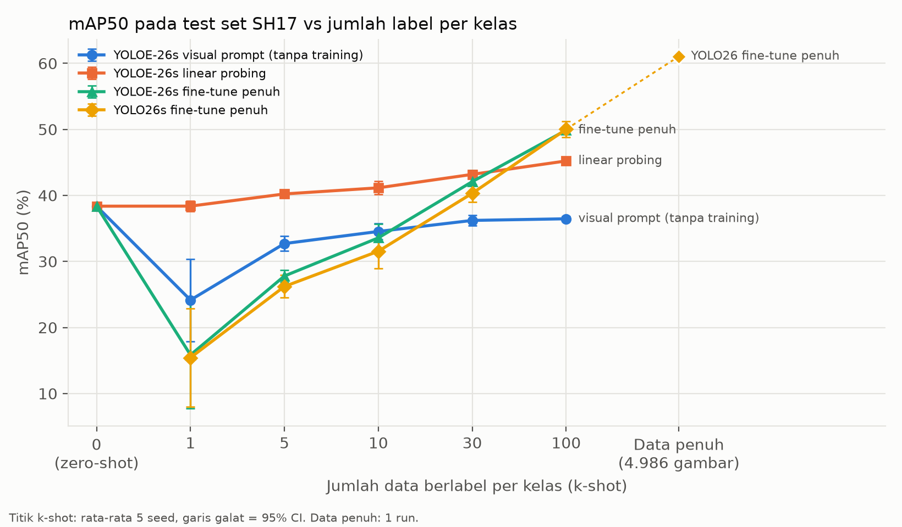
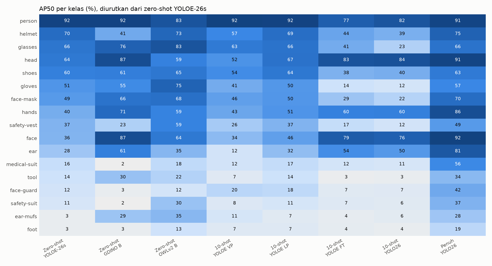

# Laporan Studi Pendahuluan

**Usulan judul:** Analisis Kebutuhan Data Berlabel pada Deteksi Alat Pelindung Diri Menggunakan Model Open-Vocabulary
dan YOLO26 dengan Skenario Zero-Shot dan Few-Shot

**Alternatif:** Analisis Kebutuhan Data Berlabel Model Open-Vocabulary dan YOLO26 pada Deteksi Alat Pelindung Diri

**Alternatif bila diminta implementasi sistem:** Analisis Kebutuhan Data Berlabel dan Implementasi Model
Open-Vocabulary untuk Deteksi Alat Pelindung Diri

Naufal Fahrozi, S1 Informatika, Universitas Mulawarman. 5 November 2026.

Ini laporan studi pendahuluan, bukan hasil skripsi. Tujuannya memeriksa apakah topik ini layak diajukan: apakah
eksperimennya bisa dijalankan di perangkat yang ada, dan apakah hasilnya cukup informatif untuk menjawab rumusan
masalah. Kriteria layak atau tidak ditulis sebelum eksperimen dijalankan. Kode, data split, dan semua angka per run
terbuka di https://github.com/NaufalFahrozi/open-vocab-ppe-label-efficiency.

## 1. Latar belakang dan gap

Detektor APD biasanya dilatih dengan ribuan gambar berlabel. Detektor open-vocabulary (YOLOE, YOLO-World, Grounding
DINO, OWLv2) bisa mencari objek hanya dari teks seperti "helmet", sehingga berpotensi mengurangi kebutuhan label.
Belum jelas seberapa jauh potensi itu berlaku untuk APD, terutama untuk kelas yang jarang dan kelas pelanggaran.

Penelitian sebelumnya hanya menguji salah satu ujung:

| Penelitian | Yang diuji | Yang belum |
|---|---|---|
| Gil & Lee (2024), Automation in Construction 164 | APD, zero-shot dengan image captioning, dibandingkan YOLO 10–50 gambar | Tanpa bounding box dan mAP; bukan detektor |
| Essien & Frimpong (2026), Sensors 26(17) | Detektor open-vocabulary vs YOLO fine-tuned | Personel tambang, satu kelas, tanpa kurva few-shot |
| Çarklı Yavuz (2026), Electronics 15(6) | YOLO26 vs YOLOv11 pada SH17 dan dataset APD lain | Supervised saja, tanpa open-vocabulary |
| Frontiers in AI (2026), deteksi pelanggaran di lokasi kerja kelistrikan | Few-shot APD K = 1, 5, 10 | Detektor closed-set, data privat, tanpa zero-shot |
| Barlybayev dkk. (2026), Computers 15(6), tinjauan sistematis 150 studi | Pemetaan penelitian deteksi APD 2010–2026 | Tidak ada studi open-vocabulary, zero-shot, atau few-shot; menyebut kelangkaan label kelas APD langka sebagai tantangan terbuka |

**Gap:** sejauh pencarian yang dilakukan (web, arXiv, OpenAlex, sampai 3 November 2026), belum ada studi yang
memetakan kurva **zero-shot → few-shot → data penuh** untuk deteksi APD multi-kelas dengan detektor
open-vocabulary modern, pada split dan test set yang sama. Pencarian ini terbatas, jadi belum membuktikan studi
seperti itu tidak ada.

## 2. Rumusan masalah

1. Berapa mAP50 dan mAP50-95 model open-vocabulary secara zero-shot pada deteksi APD dibandingkan YOLO26 yang
   dilatih dengan seluruh data?
2. Pada jumlah data berlabel per kelas berapa mAP YOLO26 menyamai model open-vocabulary yang diadaptasi dengan data
   yang sama?
3. Kelas APD mana yang AP-nya paling rendah tanpa data berlabel, terutama kelas pelanggaran (tanpa helm, tanpa sarung
   tangan)?

## 3. Metode

| Komponen | Isi |
|---|---|
| Dataset utama | SH17 (Ahmad & Rahimi, 2024): 8.099 gambar, 17 kelas, lisensi CC BY-NC-SA 4.0 |
| Test set | Split val resmi SH17, 1.620 gambar, sama untuk semua model |
| Deduplikasi | pHash dan embedding CLIP (cosine ≥ 0,95). Train tersisa 5.540 dari 6.466 gambar; 565 gambar dibuang karena mirip test |
| Dev set | 554 gambar (10% train), untuk memilih jadwal training tanpa menyentuh test set |
| Pool latih | 4.986 gambar |
| Uji lintas dataset | Construction-PPE (±1.416 gambar), 5 kelas sepadan, tidak dipakai training. Kelas pelanggaran asli `no_helmet` dan `no_gloves` |
| Zero-shot | YOLOE-26 (n–x; Sapkota & Karkee, 2026), YOLO-World-v2 (S–X), Grounding DINO (T, B), OWLv2 (B/16, L/14), prompt = nama kelas |
| Few-shot | k = 1, 5, 10, 30, 100 objek per kelas, 5 seed, sampel bersarang (protokol Wang dkk., 2020) |
| Metode few-shot | YOLOE-26s: visual prompt (tanpa training), linear probing, fine-tune penuh. YOLO-World-v2 S fine-tune. Pembanding: YOLO26s fine-tune |
| Data penuh | YOLO26s dan YOLOE-26s fine-tune, 200 epoch maksimum, patience 30 |
| Metrik | mAP50, mAP50-95, AP50 per kelas, recall kelas pelanggaran SH17 (`ear`, `face`, `hands`, `foot`), FPS |
| Statistik | Rata-rata ± 95% CI distribusi t; selisih berpasangan per seed (sampel gambar sama antar metode) |
| Perangkat | Laptop RTX 4050 6 GB VRAM |

Linear probing hanya melatih lapisan klasifikasi terakhir; fine-tune penuh melatih semua lapisan. Keduanya
dibandingkan dengan YOLO26s supaya efek bobot awal open-vocabulary terpisah dari efek cara melatih.

## 4. Hasil

### 4.1 Zero-shot vs data penuh (RM 1)

| Model | Label yang dipakai | mAP50 | mAP50-95 | Kecepatan |
|---|---|---|---|---|
| YOLOE-26s zero-shot | 0 | 38,4 | 22,5 | 47 FPS |
| YOLOE-26x zero-shot | 0 | 45,5 | 27,6 | – |
| YOLO-World-v2 S zero-shot | 0 | 40,3 | 24,4 | 66 FPS |
| Grounding DINO T zero-shot | 0 | 49,1 | 32,7 | 2 FPS |
| OWLv2 L/14 zero-shot | 0 | **55,4** | 34,1 | ±0,6 gambar/detik |
| YOLO26s data penuh | 4.986 gambar | 61,0 | 39,1 | 63 FPS |
| YOLOE-26s fine-tune data penuh | 4.986 gambar | 61,3 | 39,2 | – |

Acuan paper SH17 dengan protokol berbeda: YOLOv8s 63,7 dan YOLOv9-e 70,9 mAP50.

- Zero-shot terbaik (OWLv2-L) hanya **5,7 poin** di bawah YOLO26s data penuh, tanpa satu label pun. Namun modelnya
  jauh lebih lambat (±1,6 detik per gambar, termasuk baca file, dibanding ±16 ms YOLO26s), sehingga tidak cocok
  untuk pemantauan waktu nyata.
- Model zero-shot yang cepat (YOLOE-26s, YOLO-World-v2 S) tertinggal 21–23 poin.
- Dengan data penuh, bobot awal open-vocabulary tidak memberi keuntungan: YOLOE-26s dan YOLO26s setara.

### 4.2 Kurva efisiensi label (RM 2)

mAP50 rata-rata ± 95% CI, 5 seed:

| k per kelas | Gambar berlabel | YOLOE-26s linear probing | YOLOE-26s fine-tune | YOLO-World-v2 S fine-tune | YOLO26s |
|---|---|---|---|---|---|
| 1 | ±6 | **38,4 ± 0,8** | 15,8 ± 8,1 | 20,9 ± 7,1 | 15,4 ± 7,5 |
| 5 | ±20 | **40,2 ± 0,4** | 27,8 ± 0,9 | 32,3 ± 0,7 | 26,2 ± 1,7 |
| 10 | ±39 | **41,1 ± 1,0** | 33,6 ± 2,1 | 35,6 ± 2,1 | 31,5 ± 2,6 |
| 30 | ±109 | **43,2 ± 0,5** | 42,1 ± 1,7 | 42,2 ± 0,9 | 40,3 ± 1,3 |
| 100 | ±338 | 45,2 ± 0,2 | **49,9 ± 0,1** | – | **50,0 ± 1,2** |
| penuh | 4.986 | – | 61,3 | – | 61,0 |

Selisih berpasangan linear probing − YOLO26s: k = 1: +22,9 ± 6,9; k = 5: +14,0 ± 2,0; k = 10: +9,6 ± 2,1;
k = 30: +2,9 ± 1,4; k = 100: −4,8 ± 1,2 poin. Semua CI tidak memuat 0.

Temuan:
- **Linear probing YOLOE unggul jelas saat label sangat sedikit**, dan YOLO26 menyusul di antara k = 30 dan
  k = 100 (±109–338 gambar). Ini jawaban angka untuk RM 2.
- Linear probing di k = 1 sama dengan titik zero-shot (38,4), dan hanya naik 6,8 poin sampai k = 100. Keunggulannya
  berasal dari pengetahuan awal model, bukan dari data berlabel.
- Fine-tune penuh YOLOE hanya unggul tipis atas YOLO26s (+1,6 sampai +2,0 poin di k = 5–30) dan seri di k = 1 dan
  k = 100. YOLO-World fine-tune unggul +1,9 sampai +6,1 poin atas YOLO26s, paling besar di k kecil.
- Pola berbeda per kelompok kelas. Untuk kelas APD, linear probing unggul 31,0 poin di k = 1. Untuk bagian tubuh
  (kepala, wajah, tangan, telinga, kaki), linear probing justru kalah 10–21 poin sejak k = 5.
- **Zero-shot OWLv2-L (55,4) masih lebih tinggi daripada semua metode few-shot sampai k = 100.** Untuk menyamai
  zero-shot terbaik, YOLO26 butuh lebih dari ±338 gambar berlabel.

### 4.3 Kelas tersulit dan kelas pelanggaran (RM 3)

| Kelas | YOLOE-26s zero-shot | OWLv2-L zero-shot | YOLO26s data penuh |
|---|---|---|---|
| foot (pelanggaran) | 3,1 | 16,0 | 19,5 |
| face-guard | 12,1 | 12,9 | 42,2 |
| tool | 13,7 | 24,6 | 34,2 |
| medical-suit | 16,1 | 27,1 | 56,0 |
| safety-suit | 10,7 | 33,4 | 37,3 |
| ear-mufs | 3,4 | 40,1 | 28,5 |

- Kelas tersulit tanpa label adalah kelas yang jarang atau namanya ambigu: `foot`, `face-guard`, `tool`, dan
  pakaian pelindung (`medical-suit`, `safety-suit`). Daftarnya bergantung pada model; misalnya `ear-mufs` sangat
  sulit bagi YOLOE (3,4) tetapi tidak bagi OWLv2-L (40,1).
- Recall kelas pelanggaran SH17 (`ear`, `face`, `hands`, `foot`) sangat rendah pada YOLOE-26s zero-shot (6,4%).
  OWLv2-L dan Grounding DINO T mencapai 46–49%, sedangkan YOLO26s data penuh 65,4%.
- **Prompt negasi kalah dari deteksi lalu aturan asosiasi** (kepala yang tidak tumpang tindih dengan helm). Pada
  label turunan SH17, AP50 kepala tanpa helm dengan aturan asosiasi 90,3 (YOLO26s penuh) dan 88,7 (Grounding DINO B
  zero-shot), sedangkan prompt negasi terbaik ("bare head", OWLv2-B) 57,2.
- Pada label pelanggaran asli Construction-PPE, kedua pendekatan sama-sama rendah: AP50 `no_helmet` dan
  `no_gloves` ≤ 5 di semua model. Sebagian disebabkan definisi kotak label (lihat keterbatasan).
- Pada uji lintas dataset, Grounding DINO B zero-shot (60,0 mAP50) lebih baik daripada YOLO26s data penuh (32,0).
  Model yang dilatih hanya pada SH17 turun tajam di dataset lain.

## 5. Keterbatasan

- Satu dataset utama dan satu ukuran model (s) untuk few-shot. Data penuh hanya satu seed.
- Lima seed membuat uji statistik berdaya rendah; CI lebih informatif daripada nilai p.
- Evaluasi YOLOE-26s lewat `val()` Ultralytics dan lewat evaluator terpadu (dipakai untuk Grounding DINO dan OWLv2)
  berselisih 0,91 poin, di atas target 0,2. Perbandingan lintas keluarga model memiliki ketidakpastian ±1 poin.
- Grounding DINO dan OWLv2 hanya diuji zero-shot, tidak di-fine-tune.
- Kotak `no_helmet` Construction-PPE sering hanya menutup bagian atas kepala, sehingga AP50-nya kemungkinan terlalu
  rendah. Ditambahkan AP longgar; ambangnya (luas prediksi ≤ 4 kali label) belum diuji.
- Pada k = 100, kelas `face-guard` dan `medical-suit` memakai semua objek yang tersedia (92 dan 81).
- Jadwal training few-shot dipilih di dev set dengan satu seed.
- Pencarian literatur terbatas. Satu paper terkait (Zhang dkk., 2025, CACAIE; deteksi alat dan material konstruksi
  few-shot tanpa training) baru terbaca metadatanya; isinya belum dibaca karena akses penerbit terblokir.
- Kriteria G4 (minimal 3 kelas zero-shot dengan AP50 < 20 dan 3 kelas ≥ 50, dihitung pada model zero-shot terbaik)
  terpenuhi saat keputusan layak diambil: model terbaiknya OWLv2-B, dengan 3 kelas < 20 dan 10 kelas ≥ 50. Setelah
  OWLv2-L ditambahkan sebagai pelengkap, skrip gerbang menghitung ulang dengan model itu. Hasilnya 2 kelas < 20 dan
  11 kelas ≥ 50, sehingga G4 di `results/hasil/gerbang.md` kini tertulis gagal. Keputusan dan kriteria tidak diubah.
  Tujuan G4, yaitu adanya kelas yang sulit dan yang mudah untuk RM 3, tetap terpenuhi. Kelas yang sulit ternyata
  bergantung pada model.

## 6. Kesimpulan sementara

Eksperimen bisa dijalankan di laptop RTX 4050 dan menghasilkan kurva yang informatif: ada perbedaan konsisten
antar metode, titik setara yang jelas, dan pola per kelas yang berbeda. Ketiga rumusan masalah punya jawaban angka.
Berdasarkan kriteria yang ditulis sebelum eksperimen, topik ini dinilai layak diajukan.

## 7. Pertanyaan untuk dosen pembimbing

1. Apakah studi komparatif tanpa pembuatan sistem diterima sebagai skripsi di prodi?
2. Apakah cakupan sudah cukup, atau perlu ditambah, misalnya dataset kedua untuk training atau ukuran model lain?
3. Apakah test set, deduplikasi, dan cara sampling sudah sesuai? Kalau diubah, eksperimen few-shot dan data penuh
   harus diulang; zero-shot hanya terpengaruh jika test set diubah.
4. Judul mana yang lebih tepat, dan apakah fokus pada kelas pelanggaran perlu dipertajam?

## Referensi

1. Ahmad & Rahimi (2024). SH17: A dataset for human safety and personal protective equipment detection in
   manufacturing industry. arXiv:2407.04590.
2. Barlybayev, Milosz, Amangeldy, Li, Razakhova, Tazhibay, dkk. (2026). Systematic review of
   computer-vision technologies for personal protective equipment compliance monitoring. Computers, 15(6), 388.
   https://doi.org/10.3390/computers15060388
3. Çarklı Yavuz (2026). Electronics, 15(6), 1146.
4. Essien & Frimpong (2026). Sensors, 26(17), 5646.
5. Gil & Lee (2024). Zero-shot monitoring of construction workers' PPE based on image captioning. Automation in
   Construction, 164, 105470.
6. Sapkota & Karkee (2026). YOLOE-26. arXiv:2602.00168.
7. Violation detection in power operation sites (2026). Frontiers in Artificial Intelligence.
   doi:10.3389/frai.2026.1833234.
8. Wang, X., Huang, T. E., Darrell, T., Gonzalez, J. E., & Yu, F. (2020). Frustratingly simple few-shot object
   detection. ICML 2020.
9. Zhang, Z., Yu, Y., Pan, Z., & Antwi-Afari, M. F. (2025). Training-free few-shot construction tool and material
   detection using pre-trained vision-language model. Computer-Aided Civil and Infrastructure Engineering, 40(30),
   6004–6023. https://doi.org/10.1111/mice.70129
