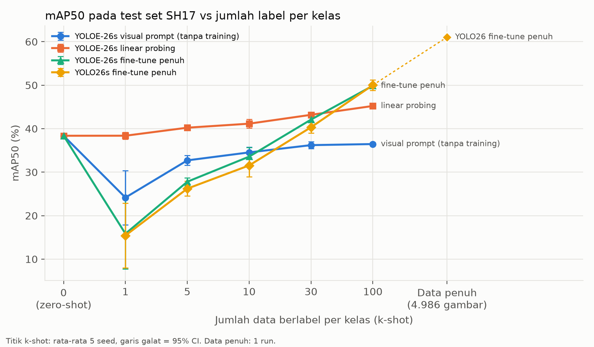
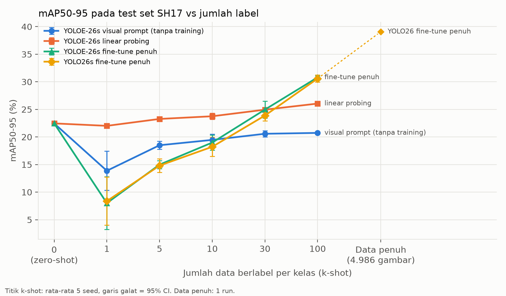
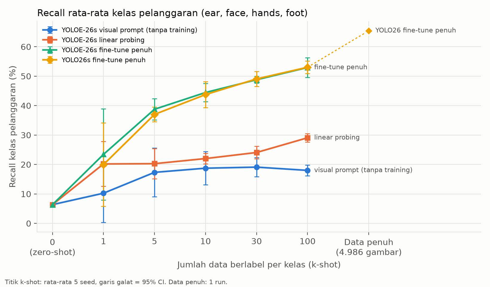
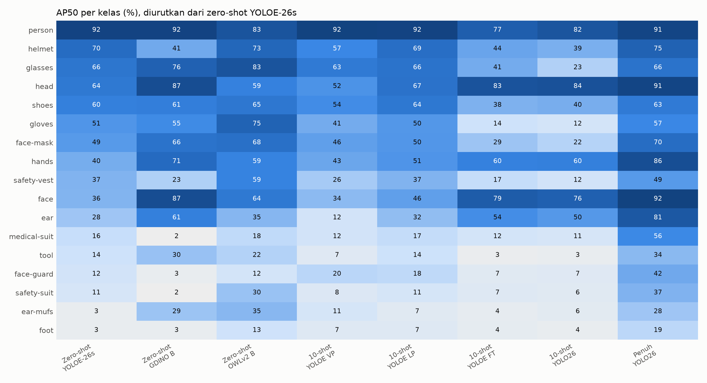

# Hasil eksperimen (otomatis dari scripts/13_analyze.py)

Kelas pelanggaran untuk recall: ear, face, hands, foot (lihat alasan di scripts/common.py).

## 1. Zero-shot, prompt = nama kelas (evaluator terpadu)

| Model | mAP50 | mAP50-95 | Recall pelanggaran | VRAM puncak (GB) | ms/gambar (termasuk baca file) |
|---|---|---|---|---|---|
| YOLOE-26n | 30,7 | 16,9 | 8,6 | – | – |
| YOLOE-26s | 38,4 | 22,5 | 6,4 | – | – |
| YOLOE-26m | 42,3 | 24,9 | 6,7 | – | – |
| YOLOE-26l | 43,2 | 25,8 | 6,4 | – | – |
| YOLOE-26x | 45,5 | 27,6 | 7,0 | – | – |
| YOLO-World-v2 S | 40,3 | 24,4 | 23,8 | – | – |
| YOLO-World-v2 M | 32,2 | 20,4 | 1,6 | – | – |
| YOLO-World-v2 L | 34,9 | 22,5 | 4,8 | – | – |
| YOLO-World-v2 X | 35,5 | 23,1 | 2,3 | – | – |
| Grounding DINO T | 49,1 | 32,7 | 48,9 | 5,59 | 411 |
| Grounding DINO B | 46,4 | 29,0 | 41,4 | 5,88 | 584 |
| OWLv2 B/16 | 50,1 | 29,3 | 27,3 | 0,85 | 320 |

Cek evaluator: YOLOE-26s lewat `val()` Ultralytics = 38,37, lewat evaluator terpadu = 37,45 mAP50 (selisih 0,91 poin; target < 0,2).

## 2. Efisiensi label: k-shot (rata-rata ± 95% CI, 5 seed)

Titik awal (k = 0): YOLOE-26s zero-shot = 38,4 mAP50, 22,5 mAP50-95, recall pelanggaran 6,4 (lewat `val()`).

| k | Metode | n seed | mAP50 | mAP50-95 | Recall pelanggaran | Waktu latih (mnt) | VRAM puncak (GB) | Gambar latih |
|---|---|---|---|---|---|---|---|---|
| 1 | YOLOE-26s visual prompt (tanpa training) | 5 | 24,2 ± 6,2 | 13,9 ± 3,6 | 10,2 ± 9,9 | 0 | – | 6 |
| 1 | YOLOE-26s linear probing | 5 | 38,4 ± 0,8 | 22,0 ± 0,4 | 20,2 ± 7,6 | 1,5 | 0,50 | 6 |
| 1 | YOLOE-26s fine-tune penuh | 5 | 15,8 ± 8,1 | 8,0 ± 4,8 | 23,4 ± 15,5 | 5,2 | 2,70 | 6 |
| 1 | YOLO26s fine-tune penuh | 5 | 15,4 ± 7,5 | 8,4 ± 4,4 | 20,0 ± 14,2 | 4,4 | 2,70 | 6 |
| 5 | YOLOE-26s visual prompt (tanpa training) | 5 | 32,7 ± 1,1 | 18,5 ± 0,7 | 17,3 ± 8,2 | 0 | – | 20 |
| 5 | YOLOE-26s linear probing | 5 | 40,2 ± 0,4 | 23,3 ± 0,3 | 20,3 ± 5,1 | 1,5 | 1,17 | 20 |
| 5 | YOLOE-26s fine-tune penuh | 5 | 27,8 ± 0,9 | 15,0 ± 0,7 | 38,8 ± 3,6 | 4,1 | 3,14 | 20 |
| 5 | YOLO26s fine-tune penuh | 5 | 26,2 ± 1,7 | 14,8 ± 1,2 | 37,0 ± 2,5 | 4,1 | 3,14 | 20 |
| 10 | YOLOE-26s visual prompt (tanpa training) | 5 | 34,5 ± 1,2 | 19,5 ± 1,1 | 18,7 ± 5,7 | 0 | – | 39 |
| 10 | YOLOE-26s linear probing | 5 | 41,1 ± 1,0 | 23,8 ± 0,5 | 22,0 ± 1,8 | 1,8 | 1,29 | 39 |
| 10 | YOLOE-26s fine-tune penuh | 5 | 33,6 ± 2,1 | 19,0 ± 1,4 | 44,4 ± 3,1 | 5,2 | 3,25 | 39 |
| 10 | YOLO26s fine-tune penuh | 5 | 31,5 ± 2,6 | 18,2 ± 1,7 | 43,7 ± 4,4 | 4,6 | 3,25 | 39 |
| 30 | YOLOE-26s visual prompt (tanpa training) | 5 | 36,2 ± 0,8 | 20,6 ± 0,6 | 19,1 ± 3,2 | 0 | – | 109 |
| 30 | YOLOE-26s linear probing | 5 | 43,2 ± 0,5 | 24,9 ± 0,3 | 24,1 ± 2,2 | 3,0 | 1,29 | 109 |
| 30 | YOLOE-26s fine-tune penuh | 5 | 42,1 ± 1,7 | 25,0 ± 1,5 | 48,8 ± 1,2 | 6,4 | 3,21 | 109 |
| 30 | YOLO26s fine-tune penuh | 5 | 40,3 ± 1,3 | 23,9 ± 1,0 | 49,1 ± 2,5 | 6,2 | 3,21 | 109 |
| 100 | YOLOE-26s visual prompt (tanpa training) | 5 | 36,5 ± 0,4 | 20,7 ± 0,2 | 18,0 ± 1,8 | 0 | – | 338 |
| 100 | YOLOE-26s linear probing | 5 | 45,2 ± 0,2 | 26,1 ± 0,1 | 29,1 ± 1,4 | 9,2 | 1,46 | 338 |
| 100 | YOLOE-26s fine-tune penuh | 5 | 49,9 ± 0,1 | 30,8 ± 0,3 | 52,9 ± 3,3 | 14,1 | 3,34 | 338 |
| 100 | YOLO26s fine-tune penuh | 5 | 50,0 ± 1,2 | 30,6 ± 0,6 | 53,0 ± 2,1 | 13,7 | 3,34 | 338 |
| penuh (120 epoch) | YOLO26s fine-tune penuh | 1 | 61,0 | 39,1 | 65,4 | 183 | 5,23 | 4986 |

Baseline paper SH17 (YOLOv9-e, data penuh, protokol berbeda): 70,9 mAP50 / 48,7 mAP50-95.

## 2b. AP50 per kelompok kelas (rata-rata ± 95% CI)

| k | Metode | APD | Bagian tubuh | Lainnya |
|---|---|---|---|---|
| 1 | YOLOE-26s visual prompt (tanpa training) | 21,1 ± 5,8 | 20,5 ± 10,6 | 48,7 ± 2,5 |
| 1 | YOLOE-26s linear probing | 36,2 ± 1,0 | 37,1 ± 3,5 | 52,1 ± 1,3 |
| 1 | YOLOE-26s fine-tune penuh | 6,4 ± 3,8 | 30,8 ± 18,1 | 25,7 ± 7,7 |
| 1 | YOLO26s fine-tune penuh | 5,2 ± 3,4 | 28,5 ± 18,2 | 33,6 ± 4,9 |
| 5 | YOLOE-26s visual prompt (tanpa training) | 31,4 ± 1,2 | 28,6 ± 3,5 | 49,2 ± 1,4 |
| 5 | YOLOE-26s linear probing | 38,4 ± 0,9 | 38,8 ± 0,8 | 52,9 ± 0,7 |
| 5 | YOLOE-26s fine-tune penuh | 15,1 ± 1,9 | 49,4 ± 2,5 | 37,2 ± 1,5 |
| 5 | YOLO26s fine-tune penuh | 11,7 ± 1,8 | 49,2 ± 3,1 | 41,0 ± 1,6 |
| 10 | YOLOE-26s visual prompt (tanpa training) | 34,0 ± 1,2 | 29,7 ± 2,4 | 49,5 ± 1,5 |
| 10 | YOLOE-26s linear probing | 38,9 ± 1,3 | 40,8 ± 0,9 | 53,2 ± 1,1 |
| 10 | YOLOE-26s fine-tune penuh | 21,2 ± 2,8 | 55,9 ± 1,6 | 39,8 ± 2,0 |
| 10 | YOLO26s fine-tune penuh | 17,7 ± 3,8 | 54,7 ± 2,7 | 42,7 ± 2,2 |
| 30 | YOLOE-26s visual prompt (tanpa training) | 36,8 ± 0,8 | 29,3 ± 1,6 | 50,4 ± 0,8 |
| 30 | YOLOE-26s linear probing | 40,9 ± 0,6 | 43,3 ± 0,5 | 54,3 ± 0,3 |
| 30 | YOLOE-26s fine-tune penuh | 32,2 ± 2,5 | 61,3 ± 0,9 | 43,4 ± 1,0 |
| 30 | YOLO26s fine-tune penuh | 28,7 ± 1,9 | 61,3 ± 0,4 | 45,9 ± 1,0 |
| 100 | YOLOE-26s visual prompt (tanpa training) | 37,0 ± 0,3 | 29,8 ± 0,7 | 50,2 ± 0,2 |
| 100 | YOLOE-26s linear probing | 43,2 ± 0,3 | 45,5 ± 0,3 | 54,5 ± 0,2 |
| 100 | YOLOE-26s fine-tune penuh | 42,7 ± 0,4 | 65,4 ± 0,5 | 46,9 ± 0,7 |
| 100 | YOLO26s fine-tune penuh | 42,1 ± 1,8 | 66,5 ± 1,0 | 48,4 ± 0,3 |

## 2c. Biaya label per k (rata-rata 5 seed)

| k | Gambar | Kotak berlabel |
|---|---|---|
| 1 | 5,8 | 72 |
| 5 | 20,2 | 285 |
| 10 | 39,0 | 518 |
| 30 | 109,2 | 1399 |
| 100 | 337,8 | 4406 |

## 2d. Titik setara linear probing vs YOLO26

| Kelompok | k setara (selisih < 2 poin atau berbalik) |
|---|---|
| Seluruh kelas | 100 |
| APD | 100 |
| Bagian tubuh | 5 |
| Lainnya | belum ada sampai k = 100 |

## 2d. Titik setara fine-tune penuh YOLOE vs YOLO26

| Kelompok | k setara (selisih < 2 poin atau berbalik) |
|---|---|
| Seluruh kelas | 1 |
| APD | 1 |
| Bagian tubuh | 5 |
| Lainnya | 100 |

## 3. Selisih berpasangan mAP50 (poin persen, per seed dengan sampel yang sama)

| k | Perbandingan | n | Selisih ± 95% CI | p (uji t berpasangan) | Seed menang |
|---|---|---|---|---|---|
| 1 | YOLOE-26s linear probing − YOLO26s fine-tune penuh | 5 | 22,9 ± 6,9 | 0,001 | 5/5 |
| 1 | YOLOE-26s fine-tune penuh − YOLO26s fine-tune penuh | 5 | 0,4 ± 1,2 | 0,391 | 3/5 |
| 1 | YOLOE-26s visual prompt (tanpa training) − YOLO26s fine-tune penuh | 5 | 8,7 ± 2,2 | 0,000 | 5/5 |
| 1 | YOLOE-26s fine-tune penuh − YOLOE-26s linear probing | 5 | -22,5 ± 7,5 | 0,001 | 0/5 |
| 5 | YOLOE-26s linear probing − YOLO26s fine-tune penuh | 5 | 14,0 ± 2,0 | 0,000 | 5/5 |
| 5 | YOLOE-26s fine-tune penuh − YOLO26s fine-tune penuh | 5 | 1,6 ± 1,1 | 0,017 | 5/5 |
| 5 | YOLOE-26s visual prompt (tanpa training) − YOLO26s fine-tune penuh | 5 | 6,5 ± 2,1 | 0,001 | 5/5 |
| 5 | YOLOE-26s fine-tune penuh − YOLOE-26s linear probing | 5 | -12,4 ± 1,0 | 0,000 | 0/5 |
| 10 | YOLOE-26s linear probing − YOLO26s fine-tune penuh | 5 | 9,6 ± 2,1 | 0,000 | 5/5 |
| 10 | YOLOE-26s fine-tune penuh − YOLO26s fine-tune penuh | 5 | 2,0 ± 1,3 | 0,014 | 5/5 |
| 10 | YOLOE-26s visual prompt (tanpa training) − YOLO26s fine-tune penuh | 5 | 3,0 ± 2,2 | 0,019 | 5/5 |
| 10 | YOLOE-26s fine-tune penuh − YOLOE-26s linear probing | 5 | -7,6 ± 2,0 | 0,001 | 0/5 |
| 30 | YOLOE-26s linear probing − YOLO26s fine-tune penuh | 5 | 2,9 ± 1,4 | 0,004 | 5/5 |
| 30 | YOLOE-26s fine-tune penuh − YOLO26s fine-tune penuh | 5 | 1,8 ± 1,4 | 0,024 | 5/5 |
| 30 | YOLOE-26s visual prompt (tanpa training) − YOLO26s fine-tune penuh | 5 | -4,1 ± 1,7 | 0,002 | 0/5 |
| 30 | YOLOE-26s fine-tune penuh − YOLOE-26s linear probing | 5 | -1,1 ± 1,4 | 0,088 | 1/5 |
| 100 | YOLOE-26s linear probing − YOLO26s fine-tune penuh | 5 | -4,8 ± 1,2 | 0,000 | 0/5 |
| 100 | YOLOE-26s fine-tune penuh − YOLO26s fine-tune penuh | 5 | -0,1 ± 1,2 | 0,769 | 3/5 |
| 100 | YOLOE-26s visual prompt (tanpa training) − YOLO26s fine-tune penuh | 5 | -13,6 ± 1,4 | 0,000 | 0/5 |
| 100 | YOLOE-26s fine-tune penuh − YOLOE-26s linear probing | 5 | 4,7 ± 0,1 | 0,000 | 5/5 |

CI yang tidak memuat 0 berarti selisih konsisten di semua sampel. Dengan n = 5, uji ini berdaya rendah; CI lebih informatif daripada p.

## 4. AP50 per kelas (%)

| Kelas | Zero-shot YOLOE-26s | Zero-shot GDINO B | Zero-shot OWLv2 B | 10-shot YOLOE VP | 10-shot YOLOE LP | 10-shot YOLOE FT | 10-shot YOLO26 | Penuh YOLO26 |
|---|---|---|---|---|---|---|---|---|
| person | 92,0 | 91,9 | 82,8 | 92,3 | 92,2 | 77,0 | 82,2 | 90,6 |
| helmet | 70,2 | 41,4 | 72,9 | 57,0 | 69,0 | 44,1 | 38,9 | 75,1 |
| glasses | 65,6 | 75,7 | 82,6 | 63,4 | 66,4 | 40,8 | 23,0 | 66,5 |
| head | 63,7 | 86,6 | 59,5 | 51,8 | 67,0 | 82,8 | 84,1 | 90,9 |
| shoes | 60,3 | 61,0 | 64,6 | 54,3 | 64,3 | 37,7 | 39,7 | 62,9 |
| gloves | 50,7 | 55,2 | 74,8 | 40,8 | 49,6 | 14,0 | 12,1 | 56,8 |
| face-mask | 48,7 | 66,5 | 68,1 | 46,3 | 50,3 | 28,8 | 21,8 | 69,9 |
| hands | 40,1 | 71,0 | 58,8 | 43,1 | 51,2 | 59,7 | 60,3 | 85,9 |
| safety-vest | 36,9 | 23,3 | 58,6 | 26,1 | 36,7 | 16,6 | 12,1 | 48,7 |
| face | 36,5 | 86,6 | 63,8 | 33,9 | 46,2 | 78,6 | 76,2 | 92,2 |
| ear | 28,3 | 60,5 | 35,4 | 12,2 | 32,4 | 54,0 | 49,5 | 80,7 |
| medical-suit | 16,1 | 1,5 | 18,1 | 12,3 | 17,1 | 11,9 | 10,7 | 56,0 |
| tool | 13,7 | 30,1 | 21,9 | 6,8 | 14,2 | 2,6 | 3,2 | 34,2 |
| face-guard | 12,1 | 3,4 | 12,1 | 20,2 | 18,4 | 6,5 | 6,7 | 42,2 |
| safety-suit | 10,7 | 1,5 | 29,9 | 8,0 | 10,9 | 7,1 | 6,4 | 37,3 |
| ear-mufs | 3,4 | 29,1 | 35,0 | 11,3 | 6,5 | 4,1 | 5,7 | 28,5 |
| foot | 3,1 | 3,2 | 13,5 | 7,2 | 7,1 | 4,3 | 3,5 | 19,5 |

## 5. Ablation prompt teks (YOLOE-26s zero-shot)

| Varian prompt | mAP50 | mAP50-95 | Recall pelanggaran |
|---|---|---|---|
| asli | 37,7 | 21,9 | 6,3 |
| deskriptif | 34,1 | 19,8 | 12,0 |
| ensemble | 37,2 | 21,8 | 13,7 |
| rapi | 37,5 | 21,7 | 6,1 |
| template | 32,4 | 19,0 | 11,8 |

Perubahan AP50 per kelas, deskriptif − rapi: medical-suit 4,3, foot 2,3, safety-vest 1,3, tool 0,5, ear-mufs 0,5, person 0,2, glasses 0,2, shoes -0,2, face-guard -1,4, hands -1,7, ear -1,9, safety-suit -3,5, face-mask -4,5, face -8,5, gloves -9,9, head -14,6, helmet -19,4

## 6. Uji lintas dataset: test Construction-PPE, 5 kelas sepadan

| Model / run | mAP50 | mAP50-95 | helmet | vest | gloves | boots→shoes | goggles→glasses |
|---|---|---|---|---|---|---|---|
| full_seed0_yolo26s | 32,0 | 12,3 | 53,6 | 46,8 | 27,0 | 29,6 | 3,0 |
| k10_seed0_yolo26s | 20,8 | 7,6 | 54,9 | 37,3 | 5,9 | 1,9 | 4,2 |
| k10_seed0_yoloe-lps | 35,9 | 12,8 | 61,0 | 55,8 | 31,7 | 25,1 | 5,7 |
| k10_seed1_yolo26s | 11,0 | 3,2 | 27,8 | 13,9 | 6,2 | 3,0 | 4,2 |
| k10_seed1_yoloe-lps | 33,3 | 11,7 | 51,0 | 56,3 | 36,6 | 16,5 | 5,9 |
| k10_seed2_yolo26s | 27,4 | 10,6 | 54,4 | 59,0 | 5,7 | 8,5 | 9,4 |
| k10_seed2_yoloe-lps | 34,4 | 12,1 | 50,7 | 56,0 | 35,6 | 23,7 | 6,1 |
| k10_seed3_yolo26s | 13,8 | 4,6 | 48,0 | 1,6 | 10,3 | 6,2 | 3,0 |
| k10_seed3_yoloe-lps | 35,9 | 12,9 | 60,4 | 56,5 | 30,0 | 26,8 | 5,5 |
| k10_seed4_yolo26s | 14,6 | 4,6 | 44,2 | 12,1 | 6,5 | 9,7 | 0,7 |
| k10_seed4_yoloe-lps | 34,1 | 12,2 | 52,8 | 57,2 | 33,9 | 21,5 | 5,3 |
| k30_seed0_yolo26s | 25,5 | 9,5 | 52,5 | 49,2 | 16,0 | 6,2 | 3,8 |
| k30_seed0_yoloe-lps | 34,8 | 12,5 | 59,9 | 55,7 | 31,4 | 21,9 | 5,3 |
| k30_seed1_yolo26s | 24,2 | 9,1 | 51,0 | 47,1 | 15,0 | 6,4 | 1,4 |
| k30_seed1_yoloe-lps | 34,6 | 12,2 | 52,0 | 57,4 | 35,3 | 22,5 | 5,6 |
| k30_seed2_yolo26s | 31,3 | 12,9 | 60,1 | 58,5 | 16,7 | 16,3 | 4,9 |
| k30_seed2_yoloe-lps | 36,8 | 13,1 | 57,8 | 58,2 | 34,2 | 27,4 | 6,4 |
| k30_seed3_yolo26s | 23,7 | 8,7 | 53,0 | 36,3 | 21,6 | 5,9 | 1,9 |
| k30_seed3_yoloe-lps | 36,0 | 12,9 | 57,9 | 58,3 | 31,8 | 25,7 | 6,3 |
| k30_seed4_yolo26s | 29,3 | 11,3 | 54,8 | 55,3 | 10,0 | 22,9 | 3,5 |
| k30_seed4_yoloe-lps | 35,3 | 12,7 | 57,3 | 57,2 | 34,3 | 22,2 | 5,6 |
| zeroshot_gdino-base | 60,0 | 25,5 | 47,3 | 87,2 | 65,9 | 54,1 | 45,7 |
| zeroshot_owlv2-base | 44,8 | 18,7 | 64,1 | 85,1 | 51,8 | 11,1 | 11,8 |
| zeroshot_yoloe-26l | 38,2 | 14,0 | 63,4 | 58,4 | 39,7 | 18,8 | 10,7 |
| zeroshot_yoloe-26s | 36,1 | 12,7 | 55,9 | 52,8 | 36,5 | 29,2 | 5,8 |
| zeroshot_yolov8l-worldv2 | 31,2 | 10,5 | 68,4 | 4,5 | 47,6 | 24,7 | 11,0 |
| zeroshot_yolov8s-worldv2 | 40,3 | 16,0 | 63,4 | 61,5 | 49,1 | 15,1 | 12,5 |

## 7b. Pelanggaran dengan label asli Construction-PPE

| Kelas | Pendekatan | Model / run | Prompt | Kotak GT | AP50 | AP longgar | AP50-95 | Recall |
|---|---|---|---|---|---|---|---|---|
| no_gloves | kelas hands | full_seed0_yolo26s | – | 556 | 4,0 | – | 0,7 | 13,7 |
| no_gloves | kelas hands | k10_seed0_yolo26s | – | 556 | 1,9 | – | 0,3 | 7,4 |
| no_gloves | kelas hands | k10_seed0_yoloe-lps | – | 556 | 1,7 | – | 0,3 | 12,2 |
| no_gloves | kelas hands | k10_seed1_yolo26s | – | 556 | 1,0 | – | 0,2 | 6,5 |
| no_gloves | kelas hands | k10_seed1_yoloe-lps | – | 556 | 1,8 | – | 0,3 | 11,8 |
| no_gloves | kelas hands | k10_seed2_yolo26s | – | 556 | 2,9 | – | 0,5 | 7,6 |
| no_gloves | kelas hands | k10_seed2_yoloe-lps | – | 556 | 1,5 | – | 0,3 | 12,1 |
| no_gloves | kelas hands | k10_seed3_yolo26s | – | 556 | 1,5 | – | 0,3 | 9,0 |
| no_gloves | kelas hands | k10_seed3_yoloe-lps | – | 556 | 1,7 | – | 0,3 | 12,6 |
| no_gloves | kelas hands | k10_seed4_yolo26s | – | 556 | 1,9 | – | 0,3 | 10,4 |
| no_gloves | kelas hands | k10_seed4_yoloe-lps | – | 556 | 1,9 | – | 0,3 | 12,8 |
| no_gloves | prompt negasi | yoloe-26l | hand without gloves | 556 | 0,7 | – | 0,2 | 6,3 |
| no_gloves | prompt negasi | yoloe-26s | hand without gloves | 556 | 0,6 | – | 0,1 | 7,2 |
| no_gloves | kelas hands | zeroshot_yoloe-26l | – | 556 | 1,5 | – | 0,4 | 23,6 |
| no_gloves | kelas hands | zeroshot_yoloe-26s | – | 556 | 1,9 | – | 0,4 | 24,1 |
| no_helmet | aturan asosiasi | full_seed0_yolo26s | – | 485 | 5,0 | 22,9 | 0,9 | 16,5 |
| no_helmet | aturan asosiasi | k10_seed0_yolo26s | – | 485 | 3,3 | 18,1 | 0,6 | 15,9 |
| no_helmet | aturan asosiasi | k10_seed0_yoloe-lps | – | 485 | 3,7 | 18,5 | 0,7 | 17,2 |
| no_helmet | aturan asosiasi | k10_seed1_yolo26s | – | 485 | 1,8 | 7,6 | 0,3 | 18,4 |
| no_helmet | aturan asosiasi | k10_seed1_yoloe-lps | – | 485 | 3,7 | 16,5 | 0,7 | 14,8 |
| no_helmet | aturan asosiasi | k10_seed2_yolo26s | – | 485 | 2,5 | 12,6 | 0,4 | 14,6 |
| no_helmet | aturan asosiasi | k10_seed2_yoloe-lps | – | 485 | 4,0 | 17,7 | 0,7 | 16,8 |
| no_helmet | aturan asosiasi | k10_seed3_yolo26s | – | 485 | 3,2 | 16,5 | 0,6 | 14,6 |
| no_helmet | aturan asosiasi | k10_seed3_yoloe-lps | – | 485 | 4,0 | 18,2 | 0,7 | 17,1 |
| no_helmet | aturan asosiasi | k10_seed4_yolo26s | – | 485 | 3,4 | 17,5 | 0,5 | 11,5 |
| no_helmet | aturan asosiasi | k10_seed4_yoloe-lps | – | 485 | 3,9 | 18,6 | 0,7 | 18,1 |
| no_helmet | prompt negasi | yoloe-26l | bare head | 485 | 2,8 | 13,6 | 0,6 | 34,6 |
| no_helmet | prompt negasi | yoloe-26l | head without helmet | 485 | 0,5 | 1,6 | 0,1 | 36,3 |
| no_helmet | prompt negasi | yoloe-26s | bare head | 485 | 3,8 | 13,6 | 0,8 | 6,8 |
| no_helmet | prompt negasi | yoloe-26s | head without helmet | 485 | 0,8 | 2,0 | 0,1 | 6,6 |
| no_helmet | aturan asosiasi | zeroshot_yoloe-26l | – | 485 | 3,4 | 16,4 | 0,6 | 10,9 |
| no_helmet | aturan asosiasi | zeroshot_yoloe-26s | – | 485 | 3,2 | 14,3 | 0,6 | 13,0 |

## 7. Kepala tanpa helm: prompt negasi vs aturan asosiasi (GT turunan, 2304 kotak)

| Pendekatan | Model / run | Prompt | AP50 | AP50-95 | Recall |
|---|---|---|---|---|---|
| prompt negasi | yoloe-26l | bare head | 45,5 | 22,7 | 83,0 |
| prompt negasi | yoloe-26l | head without helmet | 37,4 | 16,8 | 74,1 |
| prompt negasi | yoloe-26s | bare head | 44,3 | 21,1 | 38,4 |
| prompt negasi | yoloe-26s | head without helmet | 38,4 | 16,9 | 29,1 |
| aturan asosiasi | full_seed0_yolo26s | – | 90,3 | 69,2 | 86,2 |
| aturan asosiasi | k10_seed0_yolo26s | – | 82,4 | 55,9 | 76,7 |
| aturan asosiasi | k10_seed0_yoloe-lps | – | 64,5 | 35,1 | 60,9 |
| aturan asosiasi | k10_seed1_yolo26s | – | 80,1 | 50,2 | 76,9 |
| aturan asosiasi | k10_seed1_yoloe-lps | – | 66,3 | 35,8 | 63,1 |
| aturan asosiasi | k10_seed2_yolo26s | – | 84,3 | 56,2 | 76,5 |
| aturan asosiasi | k10_seed2_yoloe-lps | – | 64,8 | 34,8 | 62,5 |
| aturan asosiasi | k10_seed3_yolo26s | – | 82,6 | 55,8 | 76,6 |
| aturan asosiasi | k10_seed3_yoloe-lps | – | 64,0 | 34,6 | 60,9 |
| aturan asosiasi | k10_seed4_yolo26s | – | 83,7 | 55,2 | 77,8 |
| aturan asosiasi | k10_seed4_yoloe-lps | – | 63,6 | 34,6 | 61,1 |
| aturan asosiasi | gdino-base | – | 88,7 | 52,1 | 83,9 |
| aturan asosiasi | gdino-tiny | – | 80,7 | 54,0 | 72,7 |
| aturan asosiasi | owlv2-base | – | 59,2 | 29,5 | 59,9 |
| aturan asosiasi | yoloe-26l | – | 62,4 | 32,7 | 52,5 |
| aturan asosiasi | yoloe-26s | – | 61,1 | 31,7 | 52,8 |

## 8. Kecepatan inferensi (batch 1, FP32, 640 px untuk YOLO)

| Model | FPS end-to-end | ms/gambar | FPS forward saja | Batas daya GPU (W) | Charger |
|---|---|---|---|---|---|
| full_seed0_yolo26s/weights/best.pt | 63 | 15,8 | 112 | 83–93 | ya |
| gdino-base | 2 | 523,1 | – | 80–94 | ya |
| gdino-tiny | 2 | 393,7 | – | 80–100 | ya |
| k10_seed0_yolo26s/weights/last.pt | 63 | 15,9 | 111 | 85–93 | ya |
| k10_seed0_yoloe-lps/weights/last.pt | 46 | 21,9 | 79 | 80–93 | ya |
| owlv2-base | 3 | 313,3 | – | 80–95 | ya |
| yoloe-26l | 37 | 27,2 | 54 | 80–92 | ya |
| yoloe-26s | 47 | 21,1 | 78 | 80–84 | ya |
| yolov8l-worldv2 | 36 | 28,1 | 48 | 82–91 | ya |
| yolov8s-worldv2 | 66 | 15,2 | 120 | 81–88 | ya |

## 9. Kondisi perangkat selama training

76 run training. Charger terpasang di semua run: True. Batas daya GPU teramati 80–105 W. Rata-rata utilisasi GPU per run 15–90%. Suhu GPU maksimum 87 °C.
